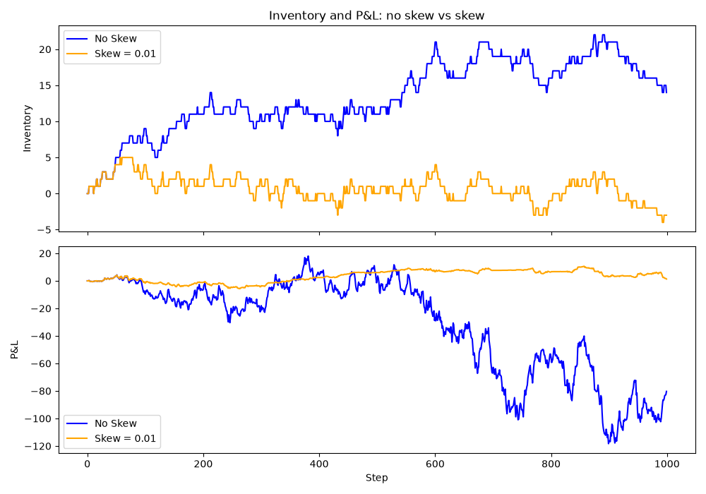

# Market-Making Simulator

A small Python simulation of a market maker quoting a bid and an ask around a random-walk price, with inventory skew and mark-to-market P&L tracking.



## The model

**Price.** The mid price follows an arithmetic random walk:

`mid[t+1] = mid[t] + sigma * sqrt(dt) * Z`, where `Z ~ N(0, 1)`

The `sqrt(dt)` is there because variance grows linearly with time, so the standard deviation of the terminal price is about `sigma * sqrt(T)`. I checked this by simulating 5,000 paths: the standard deviation of the final price was 6.31 against a theoretical 6.32.

**Quotes.** The market maker quotes around a centre that shifts with inventory:

`center = mid - skew * inventory`

`bid = center - half_spread`, rounded down to the tick

`ask = center + half_spread`, rounded up to the tick

Rounding needs care because of floating point: `99.07 - 0.03` comes out as `99.03999999999999`, so dividing by the tick and flooring would give a bid of 99.03 instead of 99.04. I round the quotient to 6 decimals before `floor`/`ceil` to avoid this.


When long, the centre moves down, so the ask becomes more attractive to buyers and the bid less attractive to sellers. This pushes inventory back towards zero.

**Fills.** The further a quote is from the true mid, the less often it fills. For a quote at distance `delta` from mid:

`rate = A * exp(-k * delta)`
`probability per step = 1 - exp(-rate * dt)`

Each side gets an independent random draw every step. Fill distances are always measured from the true mid, so skewing the quotes changes the fill probabilities.

**P&L.** Cash and inventory update on each fill, and P&L is marked to market every step:

`P&L = cash + inventory * mid`

## How to run

```bash
python3 -m venv .venv
source .venv/bin/activate
pip install -r requirements.txt

python simulate.py        # one run, prints summary
python experiment.py      # 300 seeds per skew value, prints the table below
python compare_skew.py    # saves sim_compare.png
pytest                    # run the tests
```

Parameters used throughout: `mid0 = 100`, `sigma = 2.0`, `dt = 0.01`, 1,000 steps, `half_spread = 0.05`, `A = 20`, `k = 10`, tick size 0.01.

## Results

Each row averages 300 simulations, each on a different price path.

| Skew  | Mean final P&L | Std of final P&L | Mean max abs inventory |
|-------|----------------|------------------|------------------------|
| 0.0   | 15.8           | 63.7             | 17.6                   |
| 0.002 | 10.9           | 28.3             | 10.2                   |
| 0.005 | 9.7            | 18.6             | 7.6                    |
| 0.01  | 10.1           | 13.3             | 5.9                    |
| 0.02  | 9.9            | 10.1             | 4.6                    |
| 0.05  | 7.2            | 7.0              | 3.4                    |

Skewing cuts the standard deviation of P&L by roughly nine times, from 63.7 to 7.0, and keeps inventory small. The mean falls only a little. With 300 runs the standard error at skew 0 is about 3.7, so the early drop in the mean is within noise, but the fall at skew 0.05 is probably real: skewing too hard costs some fills and spread. Skew in the range 0.02 to 0.05 gives the best return per unit of risk.

The chart above compares a single run with and without skew on the same price path. Without skew the market maker builds a position of about +15 and takes a large mark-to-market loss when the price falls. With skew, inventory stays within about +/-5 and P&L is smooth.

## Limitations

- **No adverse selection.** Fills are independent of price moves. In real markets fills are more likely just before the price moves against you, which would make the no-skew case look even worse.
- **Unit-size fills and no inventory limits.** Every fill is one unit, and the model never stops quoting however large the position gets.
- **Convenient fill model.** The exponential intensity and Poisson-style arrival are assumptions chosen for simplicity, not fitted to data.
- **Arithmetic Brownian motion.** Prices can in principle go negative, which does not happen with real prices over this range.
- **No fees, rebates or latency.**

## Possible extensions

- A hard inventory cap that stops quoting one side.
- Fill probabilities that depend on recent price moves, to model adverse selection.
- Fitting `A` and `k` to real order-book data.
- Geometric Brownian motion for the price.

## Tests

`pytest` runs four checks: quotes straddle the mid, skew moves quotes the right way, fill probability falls with distance, and the same seed reproduces the same price path.